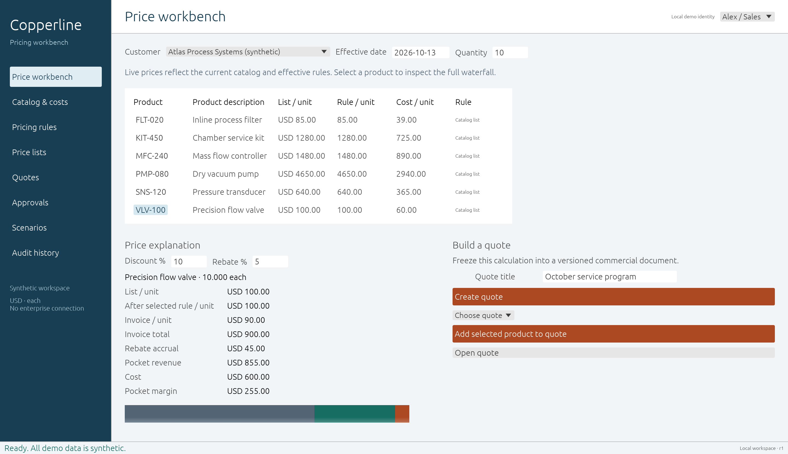

# Copperline

An independent Rust pricing workbench for synthetic industrial data. Calculate an explained price, freeze it into a quote or price list, route approval, persist every change and export approved values.

**Early functional prototype.** Full pricing-platform parity is the long-term target, not a current claim. No affiliation with Pricefx, GridCraft, ArtCraft or any industrial company. No proprietary source, company data, vendor artwork or authenticated vendor materials are included.

## Run

Install Rust **1.95.0 or newer**. From the project directory:

```sh
cargo run -p copperline-desktop -- --demo --data data/demo
cargo run -p copperline-cli -- --data data/cli-demo demo
cargo run -p copperline-cli -- --data data/cli-demo api
cargo xtask ci
```

The desktop uses a native Rust egui window with no browser or Node runtime. Windows, macOS and Linux build jobs are provided; see evidence/verification.md for what has actually run. Close one process before opening the same data directory in another.

## What works

- Product/customer catalog and effective-dated cost inputs; atomic CSV product ingestion.
- Exact cents, basis points and thousandths of units; explicit currency and no floating-point pricing.
- Versioned, effective-dated single-winner rules: fixed price, list discount or cost markup, with documented precedence.
- Live evaluation and an explained list → invoice → rebate → pocket → cost → margin waterfall.
- Frozen price lists with whole-list approval and separate local publication.
- Versioned quotes, frozen pricing data, discount/margin guardrails, separate-person approval, revision and approved CSV export.
- Deterministic scenario comparison and weighted aggregate margins.
- Durable full-state revisions with exclusive locks, checksum validation, audit records and idempotent commands.
- One command engine behind native UI, CLI, stdio and an opt-in loopback JSON API.

[Demo runbook](docs/demo.md) · [API contract](docs/api.md) · [Architecture](docs/architecture.md) · [Security boundaries](docs/security.md) · [Capability/parity matrix](docs/parity.md) · [Remaining gaps](docs/gaps.md) · [License](LICENSE)

## Development playbook

The workspace follows GridCraft's engine-first, swappable-UI, command-driven and never-crash approach. All authored code forbids unsafe Rust, and clippy rejects panics and unchecked unwraps. `cargo xtask ci` runs layering/asset checks, format, clippy and tests. The original source and UI are MIT licensed; third-party dependencies retain their licenses. See [NOTICE](NOTICE).

Publication of this source repository does not constitute a production service or an authenticated business system. Demo role labels are explicitly caller-selected. There are no ERP writes, payments, telemetry or model-based optimization claims.


